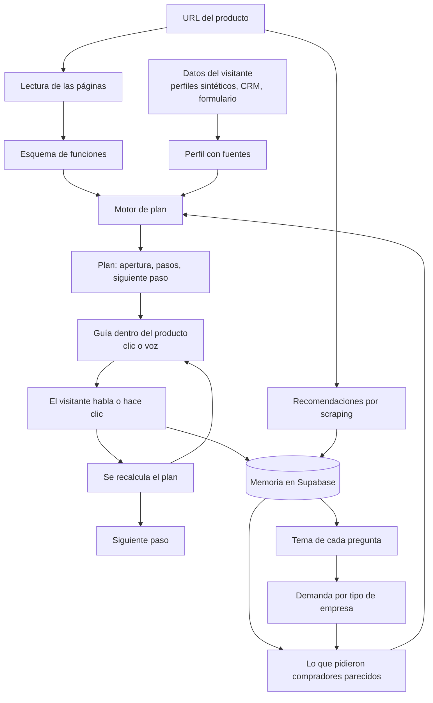

# karumi-icai-challenge

Hackathon Karumi × Comillas, ICAI, 4 de noviembre de 2026.
Brief: https://karumi.ai/hackathon

**Track 2: ¿Qué enseña primero?** Un visitante tiene 3 minutos y una sola cosa en la cabeza. Hay que decidir qué merece la pena enseñarle primero, y por qué.

## El proyecto: nextfirststep

Enlace: https://karumi-icai-challenge.vercel.app

Un motor de recomendaciones de demo. A partir del perfil del cliente y del producto, genera un primer plan para la demo y lo va cambiando en directo mientras el cliente la ve.

### 1. El primer plan

El plan incluye todo lo que el cliente tiene que saber sobre la demo: la frase de apertura, los pasos (qué decir, por qué y qué preguntar), lo imprescindible, lo que se queda fuera y el siguiente paso. Se ajusta a:

- su rol
- lo que más le preocupa (una sola cosa)
- su capacidad de decidir
- su conocimiento
- en qué momento de compra está
- los minutos que tiene

### 2. El plan en directo, con un guía dentro del producto

Un guía (un punto con ojos) acompaña al cliente dentro del producto, por clics o por voz. Cada vez que el cliente habla o hace clic, el plan se recalcula. Así no solo sabemos el primer paso: siempre sabemos el siguiente paso que hay que enseñar. Cada cliente tiene su propio plan, personalizado en directo.

## Cómo funciona

### Qué enseñamos primero, y por qué

El motor mira cada función del producto y le da puntos para este visitante. Suma si la función está hecha para su rol, si responde a lo que más le preocupa, si tiene un momento de impacto, si tiene la profundidad adecuada para lo que ya sabe, si puede firmar (entonces el precio importa) y en qué momento de compra está. Suma también si compradores parecidos ya preguntaron por esa función. Abre con la función mejor puntuada (nunca el precio), rellena los minutos con las siguientes y, si el precio entra, cierra con él.

Ejemplo: Marta Ruiz, CFO de una empresa de logística, le preocupa el coste, tiene 3 minutos y puede firmar. Su demo abre con gastos desde una foto, porque está hecha para finanzas, habla de coste y sorprende en segundos. Siguen la planificación de plantilla y presupuesto y la nómina con comprobaciones en directo, y cierra con planes y retorno de la inversión, porque ella firma y quiere saber cuándo se paga sola. El siguiente paso que le proponemos: una llamada con ventas esta semana para cerrar precio y fecha de inicio.

### Qué modelos usamos y dónde

- Motor de plan: reglas, sin modelo de lenguaje. Siempre responde, sin red, y cada decisión lleva su porqué.
- Tema de cada pregunta y recomendaciones: gpt-4o-mini.
- Voz: OpenAI gpt-realtime, que habla y usa herramientas sobre la pantalla (leer, señalar, hacer clic). Si no está disponible, la voz del navegador.

### Dónde viven los datos

- Producto: se lee de sus propias páginas y queda como un esquema de funciones.
- Visitantes: perfiles sintéticos y un CRM de ejemplo en `data/`. Cada variable del perfil guarda de dónde sale (CRM, web, formulario).
- Memoria: Supabase, con sesiones, eventos y recomendaciones. De ahí salen la demanda por tipo de empresa y los temas que ya merecen entrar en la demo.
- La clave de voz es de corta duración: `/api/session` la crea en el servidor para cada sesión.

### Partes y enlaces

- Motor de plan: https://karumi-icai-challenge.vercel.app/agent-app/
- Producto de ejemplo con el guía dentro: https://karumi-icai-challenge.vercel.app/client-site/
- Agente de voz: https://karumi-icai-challenge.vercel.app/voice-agent/
- Memoria: https://karumi-icai-challenge.vercel.app/memory/

## Lo que pide el jurado

- Tiene que poder clicarse durante la presentación, en un portátil o con un enlace.
- Se valora: que funcione, la creatividad, cuánto se ha hecho con IA y el valor para una empresa real.
- En 3 minutos: qué hemos construido, qué demuestra, su punto más débil y qué añadiríamos con una semana más.
